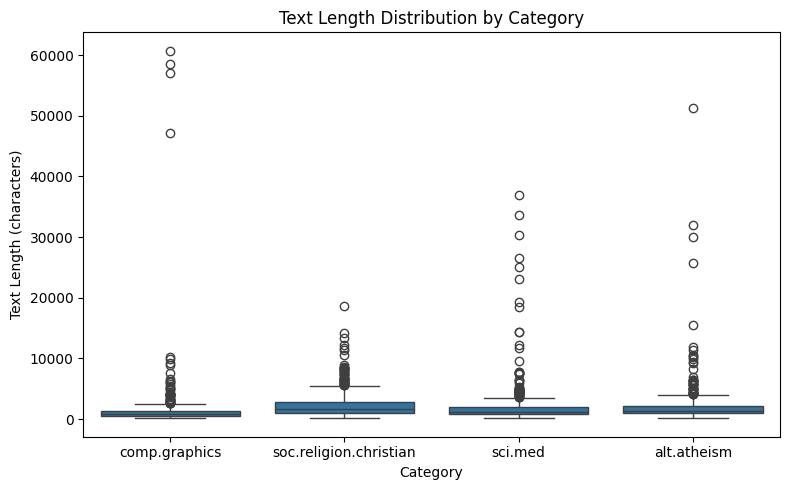
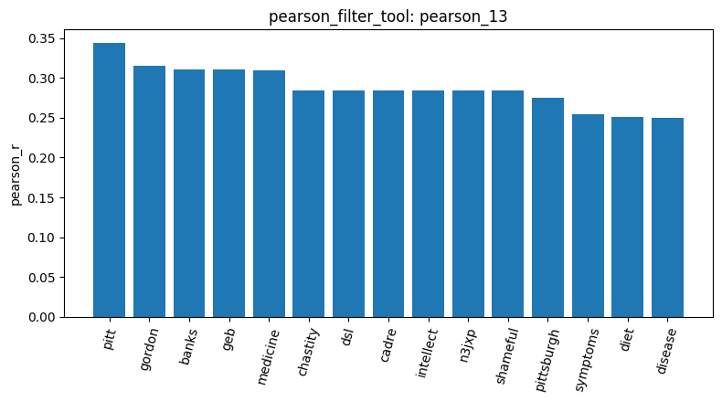
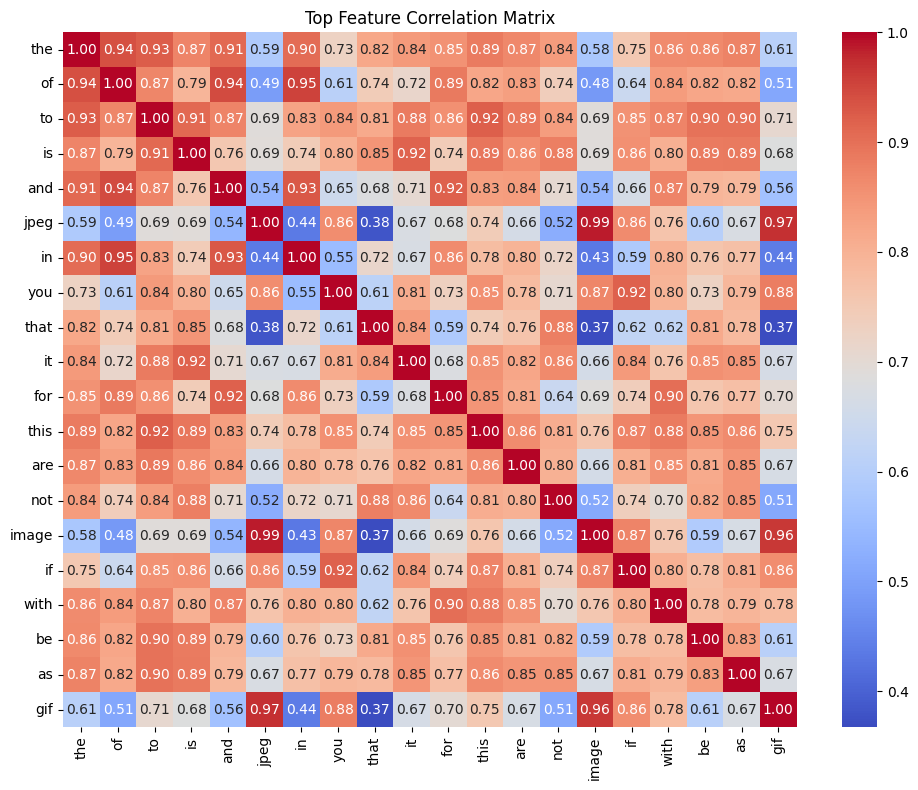
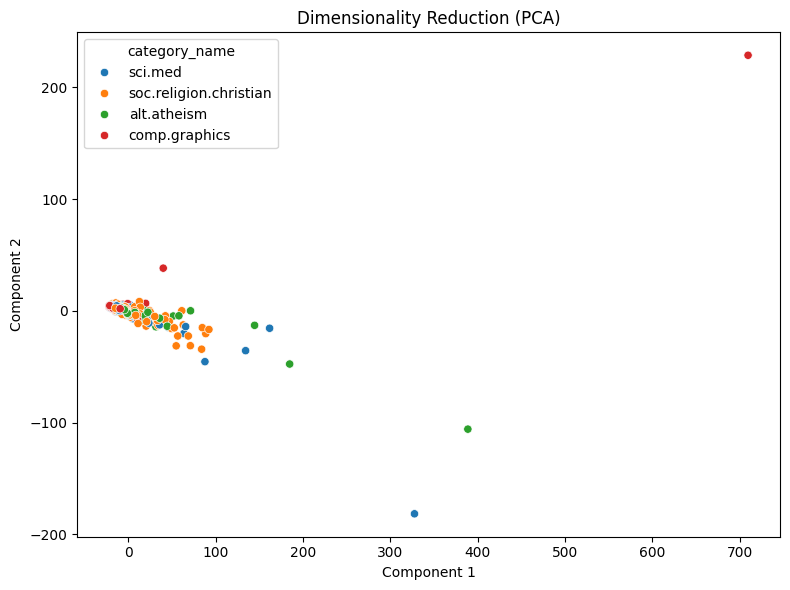
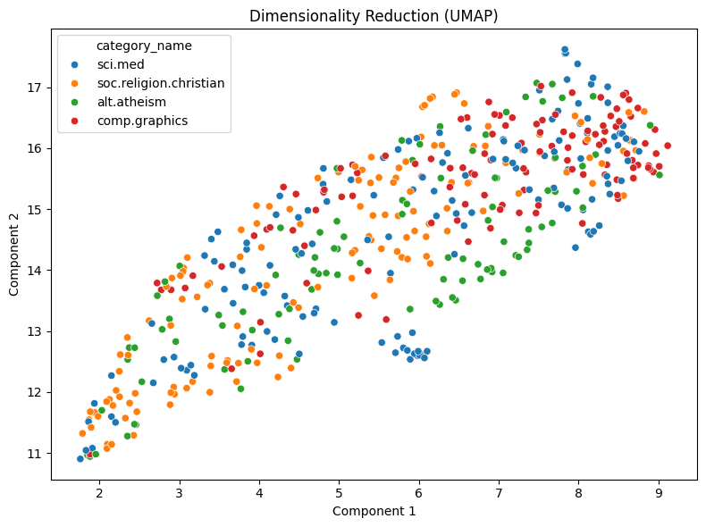
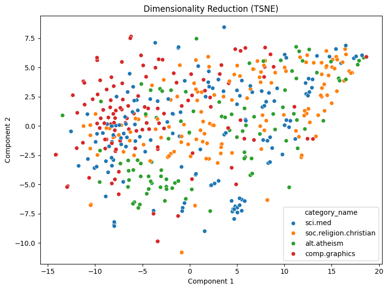

# Lab 1 Agentic Pipeline Report: 20 Newsgroups

**Name:** 熊明漢  
**Student ID:** 115065422

## 1. Data and preparation

I used my AgentDev tools to analyse four 20 Newsgroups categories: `alt.atheism`, `soc.religion.christian`, `comp.graphics`, and `sci.med`. After approving tool access and checking the project files (`list_files_1`), I loaded **2,257 documents** (`load_dataset_2`) and inspected examples (`inspect_3`). There were no missing or empty texts (`missing_4`) and no duplicate rows (`duplicates_5`), so no rows needed removal for these reasons. Document lengths varied a lot: the median was **1,235 characters**, while the maximum was **60,713** (`describe_6`). These statistics describe the full dataset. I then selected **500 documents with random_state=42** and replaced the working dataset (`sample_7`) to keep the analysis manageable. The later results describe this sample, not all 2,257 documents.

## 2. Word counts, filtering, and correlations

After tokenization (`tokenize_8`), I built a unigram DTM limited to **2,000 terms** (`dtm_9`). Its shape was **500 × 2,000**, with **56,109 nonzero entries** and **94.3891% sparsity**. Common words dominated: `the` appeared **6,622** times (`term_freq_10`), because the global DTM keeps stopwords. The small heatmap (`dtm_heatmap_11`) showed mostly zeros and numeric terms because it selected the first ten vocabulary columns, not the most frequent words. A zero row in this slice does not mean an empty document. At a variance threshold of **0.01**, all **2,000 terms** were kept (`variance_12`), so this setting removed nothing. For `sci.med`, Pearson gave `pitt` **0.3437** and `medicine` **0.3090** (`pearson_13`); Spearman gave them **0.3663** and **0.3546**, and ranked `disease` among its strongest positive terms (`spearman_14`). Spearman compares ranks rather than raw count magnitudes. Some associated terms, such as `pitt` and `gordon`, may reflect authors or institutions as well as topic. Separately, `jpeg` and `image` had a term-to-term correlation of about **0.99** (`feat_corr_15`). Raw document length could contribute to count correlations, but I did not test its contribution. These global filtering tools report scores; they do not automatically shrink the DTM.

## 3. Frequent patterns

I compared TF-IDF filtering followed by Top-K mining with **k=10** for `sci.med` (`patterns_16`) and `comp.graphics` (`patterns_19`). Pattern mining builds its own category-specific DTM and removes English stopwords, but it does not remove message headers. In `sci.med`, `subject` had support **145** and the pair `subject, organization` had support **142**. In `comp.graphics`, `subject` had support **119** and the same pair had support **117**. Both lists were dominated by `subject`, `organization`, `lines`, and `edu`. These patterns mostly describe message formatting rather than medical or graphics topics. Higher raw support does not by itself mean a stronger topic relationship: category sizes in the sample also matter. I did not calculate relative supports, so I cannot use these counts alone to rank which category has stronger associations.

## 4. Dimension reduction and labels

I generated two-dimensional PCA (`dim_red_17`), UMAP with **n_neighbors=15** (`dim_red_20`), and t-SNE with **perplexity=30** (`dim_red_21`), using **random_state=42**. PCA showed many points close to the origin and a few distant outliers. UMAP spread the documents along an elongated shape, while t-SNE produced a more spread-out arrangement with some small local groups. However, category colours still overlapped substantially in all three plots. I cannot claim that the nonlinear methods clearly separated the categories or that these plots demonstrate classification accuracy. Long or repetitive documents could influence PCA, but I did not inspect the outlier documents to confirm that explanation. **The t-SNE run produced a plot, but its separate Known Answer 8 fixture coordinates did not match the reference within the test tolerance. That issue remains unresolved; this successful run does not mean the reference test passed.** Label encoding (`bin_labels_22`) produced one-hot labels for the 500 documents, with columns ordered as `alt.atheism`, `comp.graphics`, `sci.med`, and `soc.religion.christian`. These columns represent categories, not an ordered numerical scale.

## 5. Document similarity and limitations

I inspected the current sample (`inspect_23`) before selecting document pairs. Documents **4 and 5**, both from `alt.atheism` and the same author, had cosine similarity **0.438** (`cosine_sim_24`). Documents **0 and 8**, from `sci.med` and `comp.graphics`, had similarity **0.3803** (`cosine_sim_25`). The same-category pair scored higher, but the scores were fairly close. The returned texts showed that document 0 discussed Waco despite its `sci.med` label, while document 8 asked about XLib displays. This shows why category labels alone do not explain similarity. Shared headers, common words, and author information can contribute to overlap in these raw count vectors; I did not measure their individual effects. Two pairs are examples, not evidence that same-category pairs always score higher. The sample size, vocabulary limit, retained headers and stopwords, and unresolved t-SNE test all limit how broadly I can interpret the results.
