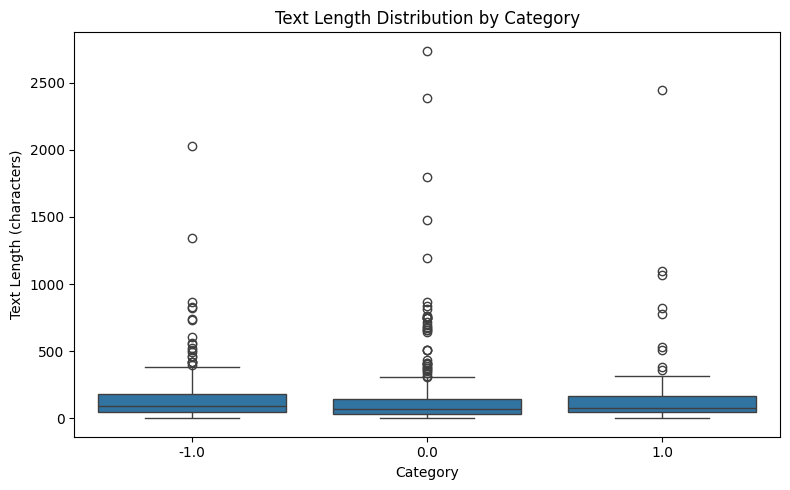
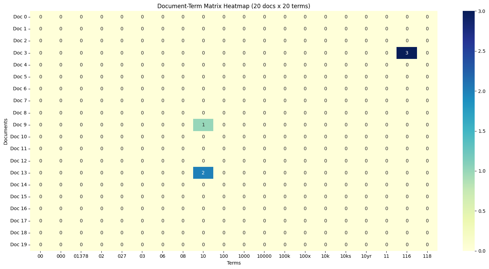
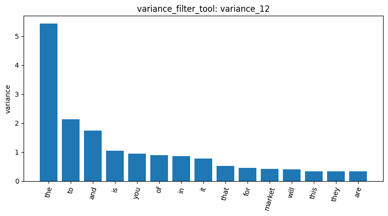
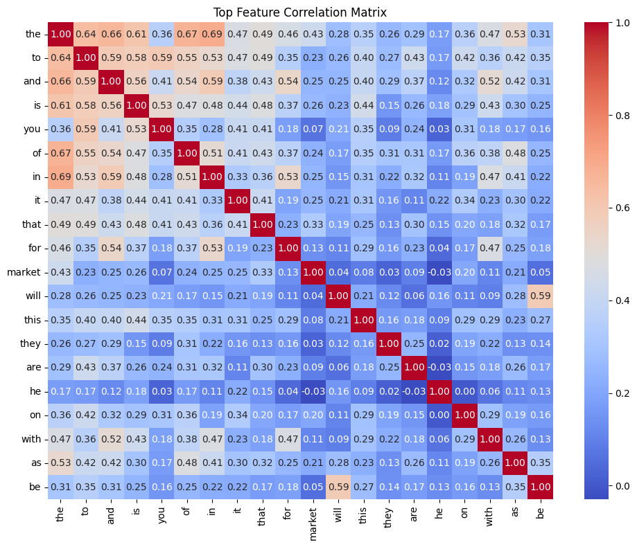
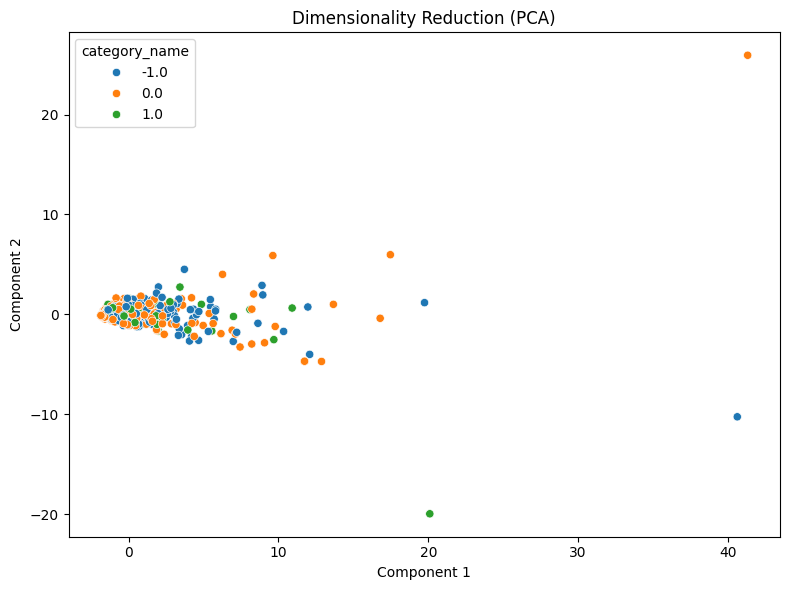
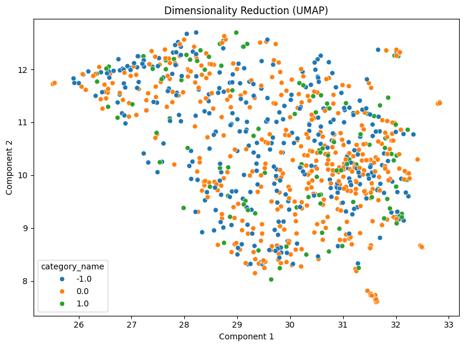
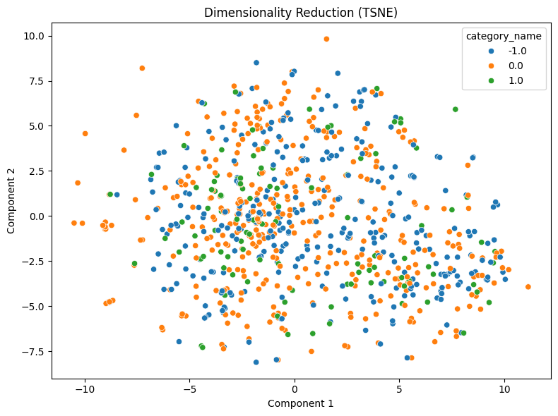

# Lab 1 Homework Report: Reddit Stock Sentiment

**Name:** 熊明漢  
**Student ID:** 115065422

## 1. Data and basic checks

I used the AgentDev tools on `newdataset/Reddit-stock-sentiment.csv`. After approving access, I located the file with `list_files_1` and loaded **847 posts** with `load_dataset_2`: **315 negative, 423 neutral, and 109 positive**. I inspected five rows (`inspect_3`) and kept the full dataset without sampling. `missing_4` found no missing text. `duplicates_5` reported **23 extra duplicate rows**; I used `drop=False`, so repeated posts stayed and could increase counts and pattern support. In `describe_6`, the median length was **78 characters**, the mean **147.44**, and the maximum **2,737**. These are characters, not tokens. The boxplot shows mostly short posts, some long outliers, and overlapping lengths across categories.

## 2. Word counts, filtering, and correlations

After tokenization (`tokenize_7`), I built a unigram DTM with no vocabulary limit (`dtm_8`): **847 documents, 4,346 terms, 17,193 nonzero entries, and 99.5329% sparsity**. The frequency results (`term_freq_9`, `term_freq_10`) included `the` **920** times and `market` **111** times. Common words dominate because this DTM keeps stopwords. The heatmap (`dtm_heatmap_11`) shows the first 20 documents and first 20 alphabetical terms, mostly numeric tokens. Only three cells are nonzero, but that does not mean the documents are empty. The filtering results below report scores and selections without replacing the global DTM. The correlation heatmap uses its 20 highest-variance terms, and high variance does not automatically mean useful sentiment information.

| Result | Finding and meaning |
|---|---|
| `variance_12` | At threshold **0.01**, **506 terms** were marked kept and **3,840** removed. Terms with variance at or below the threshold were removed from the selection. |
| `pearson_13` | Against positive sentiment (`"1.0"`), `technology` scored **0.1514** and `china` **-0.0619**. The latter is a weak association with being **neutral or negative combined**, not proof of negative sentiment. |
| `spearman_14` | `technology` scored **0.1599** and became the leading positive term. Spearman uses ranks rather than raw counts, so unusually large counts can affect its ranking differently from Pearson. Both associations are weak. |
| `feat_corr_15` | `in` and `the` correlated at **0.6943**. Common words can vary together because of sentence structure and document length, rather than sentiment. |

## 3. Patterns in each sentiment category

I used **TF-IDF filtering and Top-K mining with `k=20`** for each category (`patterns_16`–`patterns_18`). This tool builds separate category vocabularies and removes English stopwords. Support counts documents containing a pattern, not total word occurrences. `market` mainly describes a shared topic. `good` and `better` can suggest positive sentiment, but `good` appears in all three categories, and `bad` has support **4** in the positive result. Words need context. In neutral posts, `[com, stockbuyvest]` has support **20** and `x200b` has support **15**, showing the influence of links and formatting. Category sizes also differ, so raw support counts alone are not a fair measure of which category a pattern is most associated with.

| Selected pattern | Negative: `patterns_16` | Neutral: `patterns_17` | Positive: `patterns_18` |
|---|---:|---:|---:|
| `market` | 23 | 37 | 7 |
| `good` | 13 | 15 | 12 |
| `trump` | 45 | 23 | Not in returned top 20 |
| `china` | 33 | 22 | Not in returned top 20 |
| `better` | Not in returned top 20 | Not in returned top 20 | 5 |

*“Not in returned top 20” does not mean the pattern never occurs.*

## 4. Comparing PCA, UMAP, and t-SNE

I reduced the same global DTM to two dimensions with **`random_state=42`**. PCA (`dim_red_19`) explained **27.0%** of variance on the first axis and **4.99%** on the second; most points overlap near the origin, with a few distant points. UMAP (`dim_red_20`, **`n_neighbors=15`**) and t-SNE (`dim_red_21`, **`perplexity=30`**) spread the points out more. However, all three plots have mixed sentiment colours. The agent described UMAP as having the clearest clustering, but I would not call it a clear winner for sentiment separation. Visible groups can reflect vocabulary and parameter choices rather than sentiment. A more separated picture is not necessarily a better representation, and these plots do not measure classification accuracy.

## 5. Label encoding and document similarity

`bin_labels_22` encoded **847 labels** into three columns ordered as **negative, neutral, positive**: `[1, 0, 0]`, `[0, 1, 0]`, and `[0, 0, 1]`. This identifies categories without treating their codes as distances; no plot is needed. Documents **0 and 1** had cosine similarity **0.0** (`cosine_sim_23`) because they shared no DTM terms, which does not prove their meanings are unrelated. Documents **110 and 161** scored **0.4078** (`cosine_sim_24`): both discuss lump-sum investing and mention SCHD and FXAIX, although their labels are positive and neutral. Word-count similarity can find shared vocabulary but cannot determine sentiment by itself. This also helps explain the overlapping reduction plots and topic words shared across categories.
